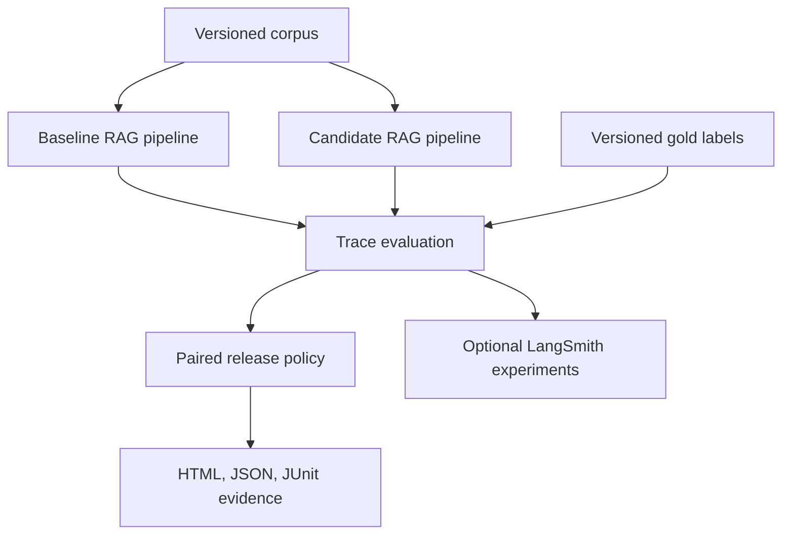

# Architecture and metric contracts

The application under test receives a question, retrieves documents with BM25, and produces an answer. The evaluator independently receives gold labels and the resulting trace. Generation never receives reference answers or retrieval labels.



## Components

| Module | Responsibility |
|---|---|
| `models.py`, `io.py` | Strict configuration, case, document, trace and score contracts; JSONL identities and input hashes |
| `retrieval.py` | BM25 ranking with explicit active/trusted metadata filters |
| `pipeline.py` | Extractive demo or an explicitly configured compatible model; records application latency and generation failures |
| `metrics.py` | Gold document ID, literal required fact, token containment, refusal and forbidden-phrase checks |
| `adapters/` | Real SDK metrics, schema-aware judge, LangSmith experiment export |
| `gate.py` | Applicability/completeness checks, per-metric floors, regression policy, critical checks, cluster bootstrap, p95 latency |
| `runner.py` | Paired run/replay orchestration with concurrency bounded to 1–8 case tasks |
| `reporting.py` | One canonical JSON result projected into local HTML, Markdown and JUnit |

## Metric meaning

All numeric quality metrics range from 0 to 1 and higher is better. Their meanings are not interchangeable.

| Namespace | Metric | Meaning | Applicable cases |
|---|---|---|---|
| `retrieval` | `recall` | Relevant gold document IDs retrieved / total relevant IDs | Answerable |
| `retrieval` | `precision` | Relevant IDs retrieved / all retrieved IDs | Answerable |
| `retrieval` | `mrr` | Reciprocal rank of first gold document | Answerable |
| `builtin` | `required_facts` | Fraction of normalized required phrases found literally in the answer | Answerable |
| `builtin` | `token_support` | Fraction of unique answer tokens present in retrieved text after removing citation markers and stopwords | Answerable |
| `builtin` | `safety` | No normalized forbidden phrase found | All |
| `builtin` | `refusal` | Answer matches the normalized documented refusal string | Unanswerable |
| `ragas` | `faithfulness` | RAGAS claim support against retrieved context | Answerable |
| `ragas` | `context_precision` | RAGAS reference-based context usefulness ranking | Answerable |
| `ragas` | `context_recall` | RAGAS reference claim attribution to context | Answerable |
| `deepeval` | `faithfulness` | DeepEval faithfulness using the explicit LLM evaluation mode | Answerable |
| `deepeval` | `answer_relevancy` | DeepEval answer statement relevance to the question | Answerable |

Token support cannot detect a meaning-changing rearrangement or an incorrect answer extracted from a stale source. The synthetic baseline illustrates this: token support can remain perfect while required facts are wrong. Framework judge scores also have distinct implementations and are never pooled into a universal faithfulness score.

Unanswerable cases have no positive retrieval reference. Assigning them perfect retrieval or semantic scores would inflate the results, so those metrics are explicitly N/A. Each report records both the actual and expected applicable paired case count. A missing metric, an illegal N/A, nonfinite value, generation error, or judge error cannot become a success.

## Paired comparison

The same cases are evaluated on both sides. Per-metric deltas are `candidate - baseline`. The bootstrap resamples topic groups, preserving baseline/candidate pairs and keeping paraphrases of a topic together. It estimates uncertainty conditional on this synthetic topic sample; it does not estimate model nondeterminism or production population performance.

The gate combines absolute candidate floors, maximum paired mean drop, critical deterministic case floors, complete evaluations, and application p95 latency. It also fails when the entire 95% bootstrap delta interval lies below the permitted drop. A wide interval cannot certify equivalence. For a noisy live judge, add repeated runs and a separate judge calibration study before depending on these defaults.

Category slices are diagnostic in v0.1. Only critical per-case and global policies determine the release decision. Application latency includes retrieval and answer generation, excludes judge execution, and must not be compared between extractive and live runs as if they were the same workload. Tokens are provider-reported when available, otherwise null.

## Model calls

Generation uses an explicit HTTP Chat Completions-compatible endpoint. RAGAS uses the native async OpenAI client and RAGAS `llm_factory` plus collections metrics. RAGAS's JSON object requests carry the required schema in the prompt. DeepEval uses a custom `DeepEvalBaseLLM` with JSON Schema requests and Pydantic response validation. Both framework adapters enforce a per-metric wall timeout. DeepEval evaluation mode is explicitly `llm` to avoid depending on a user's global configuration.

The reference configuration targets instruction models supporting temperature 0 and the documented structured output contracts. Some reasoning models have different token or temperature requirements; they need an adapter adjustment and contract tests. Generation has no automatic retries. The native RAGAS client has HTTP retries disabled; SDK-level behavior remains governed by the locked SDK implementation. No metric error falls back to a heuristic score.

For local use, a model server and downloaded weights are separate dependencies. This repository does not bundle model weights or infer that a small local model is a calibrated evaluator.

## Persistence and privacy

Output consists of local artifacts. Reports contain question/answer/context data and therefore inherit their sensitivity. API keys are not written into report metadata. Endpoint URLs reject embedded credentials and query parameters. Provider errors are represented by exception type instead of raw HTTP bodies. SDK telemetry/tracing flags are disabled before framework imports. Only `langsmith --upload` initiates experiment export to the configured LangSmith service.

The provenance report preserves corpus/dataset/config SHA-256, selected IDs, profiles, package versions and requested endpoint/model settings. Model weights/digests and server-side model routing are not captured automatically in v0.1; retain server configuration separately for exact live reproducibility.

## Dependency maintenance

The tested RAGAS release imports legacy LangChain community modules, so the compatible 0.3 family is pinned. `uv.lock` resolves all extras and supported Python versions. Exported requirements are for the Docker image and pip-only installations:

```bash
uv lock
uv export --frozen --no-emit-project --no-hashes --no-dev --output-file requirements.txt
uv export --frozen --extra eval --no-emit-project --no-hashes --no-dev --output-file requirements-eval.txt
uv sync --frozen --all-extras
make check
```

## Deliberate v0.1 limits

BM25 and metadata filters make the retrieval experiment small and explainable. There is no vector database, UI service, login, orchestration service, production monitoring, or agent benchmark in this release. This is an evaluation library/CLI with an evidence report. LangSmith export handles completed experiment evidence; it is not an online tracing deployment. Docker and GitHub Actions configurations are supplied, with execution status recorded in `VALIDATION.md`.
